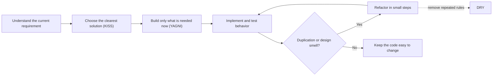

# 🧼 Clean Code

Runnable Java examples for practical clean-code principles. Each topic is an
independent Gradle module with a concise guide and focused JUnit tests.

Built with **Java 21** and Gradle 9.8.1. Install JDK 21, then run from this
repository root:

```sh
./gradlew test
./gradlew build
./gradlew :dry:test
```

## A practical improvement loop



Refactoring should preserve observable behavior; tests provide a safety net.
DRY means avoiding duplicated knowledge, not mechanically eliminating every
similar-looking line.

| Topic | Module | The quick idea |
| --- | --- | --- |
| Don't Repeat Yourself (DRY) | [dry](dry/README.md) | Keep one authoritative home for a rule. |
| Keep It Simple (KISS) | [kiss](kiss/README.md) | Prefer the clearest solution that meets the need. |
| You Aren't Gonna Need It (YAGNI) | [yagni](yagni/README.md) | Build today's requirement, not imagined future features. |
| Code Smells | [code-smells](code-smells/README.md) | Recognize structures that make change harder. |
| Refactoring | [refactoring](refactoring/README.md) | Improve internal structure while preserving behavior. |

Every topic has runnable source under `src/main/java` and tests under
`src/test/java`. Examples use only the JDK at runtime.

Further reading: Martin Fowler's
[refactoring catalog](https://refactoring.com/catalog/) provides named,
behavior-preserving structural transformations beyond these small examples.
