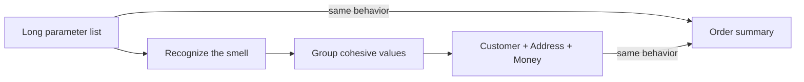

# Code Smells

`LegacyOrderSummary` shows a long parameter list made of unrelated primitives:
customer name, email, street, city, postal code, and total. The improved model
groups related values into `Customer`, `Address`, and `Money`, making invalid
combinations harder to express. The test compares both outputs to show the
behavior stays the same while the API gets clearer. This is not a claim that
every primitive is a problem.

**What a smell means:** a symptom that may indicate a design problem, not proof
of a bug. Confirm the context before changing code; common smells include long
methods, duplicated knowledge, feature envy, and primitive obsession.

Example: [`LegacyOrderSummary`](src/main/java/com/absolutebonkers/cleancode/smells/LegacyOrderSummary.java),
[`OrderSummary`](src/main/java/com/absolutebonkers/cleancode/smells/OrderSummary.java),
[`Customer`](src/main/java/com/absolutebonkers/cleancode/smells/Customer.java),
[`Address`](src/main/java/com/absolutebonkers/cleancode/smells/Address.java),
[`Money`](src/main/java/com/absolutebonkers/cleancode/smells/Money.java) ·
Test: [`OrderSummaryTest`](src/test/java/com/absolutebonkers/cleancode/smells/OrderSummaryTest.java).

Run with `./gradlew :code-smells:test` from the repository root.
