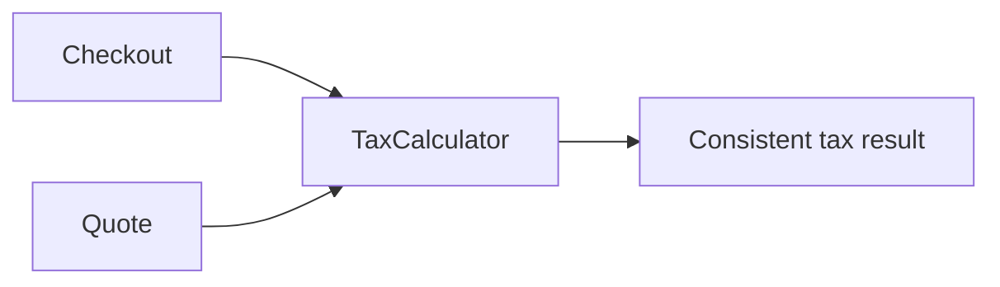

# Don't Repeat Yourself (DRY)

Tax rules belong in one `TaxCalculator`, rather than being copied into every
checkout or quote flow. Both callers delegate to the same rule, so a rate or
rounding change has one source of truth.

**Use it for:** duplicated knowledge or business rules that can drift apart.
DRY does not mean eliminating all repeated syntax; two similar lines may
represent different concepts and should remain separate.

Examples: [`TaxCalculator`](src/main/java/com/absolutebonkers/cleancode/dry/TaxCalculator.java),
[`Checkout`](src/main/java/com/absolutebonkers/cleancode/dry/Checkout.java),
[`Quote`](src/main/java/com/absolutebonkers/cleancode/dry/Quote.java) ·
Test: [`TaxCalculatorTest`](src/test/java/com/absolutebonkers/cleancode/dry/TaxCalculatorTest.java).

Run with `./gradlew :dry:test` from the repository root.
