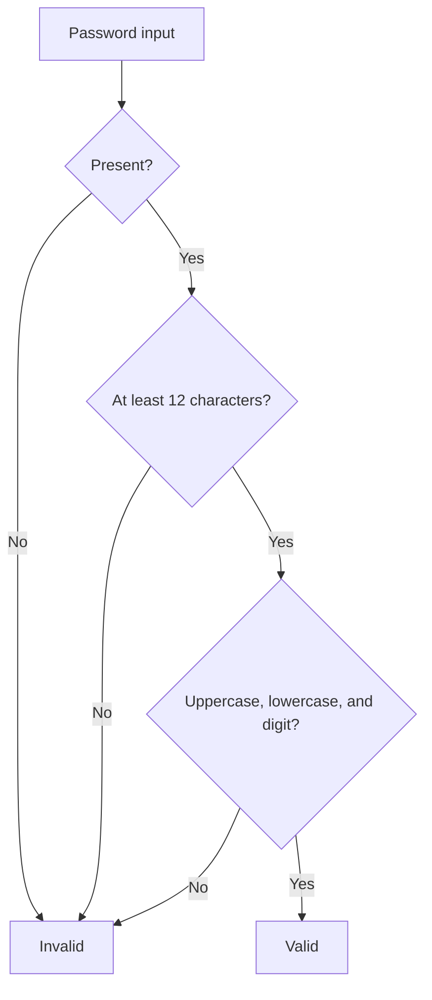

# Keep It Simple (KISS)

Password validation uses direct, readable conditions instead of a configurable
rule engine or a single hard-to-read regular expression. The method states the
requirements plainly and returns one useful result.

**Use it for:** choosing the smallest design that fully meets current
requirements. Simplicity is not the same as ignoring edge cases or removing
necessary validation; keep the requirements explicit.

Example: [`PasswordValidator`](src/main/java/com/absolutebonkers/cleancode/kiss/PasswordValidator.java) ·
Test: [`PasswordValidatorTest`](src/test/java/com/absolutebonkers/cleancode/kiss/PasswordValidatorTest.java).

Run with `./gradlew :kiss:test` from the repository root.
