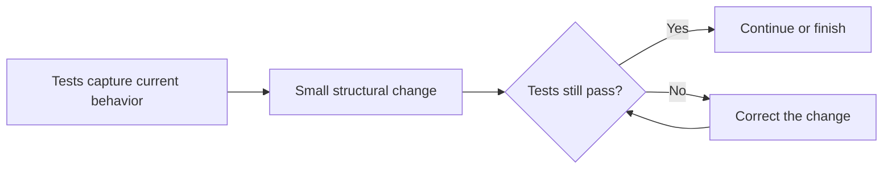

# Refactoring

The example extracts the cart's total calculation into a named operation and
models each line as `CartItem`. Its public behavior is still the same: an empty
cart totals zero, and a populated cart totals the sum of each price times its
quantity. The tests characterize that behavior.

**Safe sequence:** establish behavior with tests, make one small structural
change, rerun tests, and review the result. Refactoring changes internal
structure without intentionally changing observable behavior; feature work
should be kept distinguishable from refactoring.

Examples: [`Cart`](src/main/java/com/absolutebonkers/cleancode/refactoring/Cart.java),
[`CartItem`](src/main/java/com/absolutebonkers/cleancode/refactoring/CartItem.java) ·
Test: [`CartTest`](src/test/java/com/absolutebonkers/cleancode/refactoring/CartTest.java).

Run with `./gradlew :refactoring:test` from the repository root.
