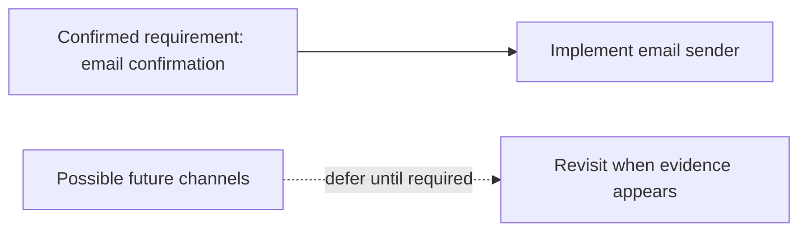

# You Aren't Gonna Need It (YAGNI)

The current requirement is to send an order confirmation by email. The example
does just that; it avoids speculative channel registries, plugin systems, and
configuration for channels that do not exist yet. Add those only when a real
requirement calls for them.

**Use it for:** avoiding speculative features that increase code and
maintenance cost without serving a current need. YAGNI does not mean ignoring
known requirements or designing a system that cannot reasonably evolve.

Examples: [`OrderConfirmation`](src/main/java/com/absolutebonkers/cleancode/yagni/OrderConfirmation.java),
[`EmailSender`](src/main/java/com/absolutebonkers/cleancode/yagni/EmailSender.java) ·
Test: [`OrderConfirmationTest`](src/test/java/com/absolutebonkers/cleancode/yagni/OrderConfirmationTest.java).

Run with `./gradlew :yagni:test` from the repository root.
